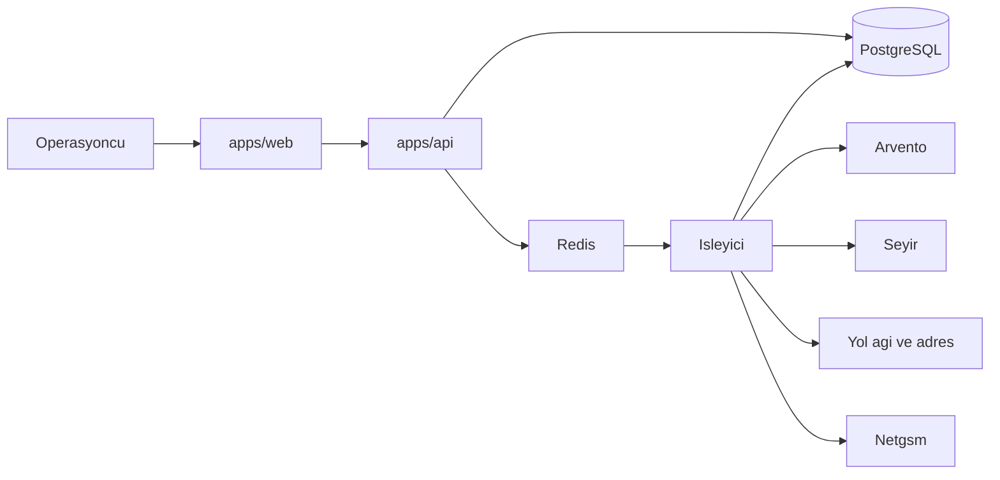

# Mimari ve teslimat planı

Bu plan [iş gereksinimlerini](brd.md) ve [iş kurallarını](is-kurallari.md) ilk sürüme indirir. Uygulama iskeleti, belgeler incelendikten sonra açılır.

## 1. Kararlar

| No | Karar |
| --- | --- |
| D-1 | Tek depo. `apps/api` Python hizmeti, `apps/web` web arayüzü, `docs` bu belgeler. |
| D-2 | Hizmet FastAPI ile yazılır. Sözleşme OpenAPI’dir. Web tipleri bu şemadan üretilir. |
| D-3 | Arayüz Vite, React ve TypeScript ile yazılır. Operasyon ekranı harita ve kuyruk üzerine kuruludur. |
| D-4 | Veri PostgreSQL’dedir. Konumlar PostGIS tipindedir. |
| D-5 | Firmalar aynı veritabanını paylaşır. Her operasyon tablosunda `tenant_id` vardır. Sorgu bu alan olmadan yazılmaz. |
| D-6 | Takograf sayıları `TR-AETR-2026` kaydındadır. Plan, hesap anındaki paket kimliğini kopyalar. |
| D-7 | Arvento ve Seyir, ortak `VehicleSnapshot` üreten adaptörlerdir. Planlama kodu sağlayıcı adı bilmez. |
| D-8 | Yol mesafesi ve adres çözümleme de aynı şekilde arayüzün arkasındadır. Sağlayıcı, pilot firma seçilince bağlanır. |
| D-9 | Periyodik çekme ve eşleştirme, API sürecinden ayrı bir işleyicide çalışır. Kuyruk Redis’tedir. |
| D-10 | Dönüş eşleşmesi tam atama problemidir. İlk sürümde OR-Tools’un atama çözücüsü kullanılır. |
| D-11 | Rota SMS’i platformun tek Netgsm hesabından, REST v2 ile gider. Atama, Netgsm iş kimliği dönünce kilitlenir. |

## 2. Depo

```text
apps/
  api/                 FastAPI, adaptörler, kural motoru, çözücü
  web/                 operasyon ve firma yönetimi
docs/
  brd.md
  is-kurallari.md
  mimari-ve-teslimat.md
```

Python bağımlılıkları `uv` ile, web bağımlılıkları `pnpm` ile yönetilir. Kökte bir `Makefile`, hizmeti, arayüzü ve işleyiciyi birlikte kaldırır. JavaScript iş hattı Python testini çalıştırmaz.

## 3. Bileşenler



Web, sağlayıcıya ve veritabanına doğrudan gitmez. İşleyici, çektiği ham cevabı ortak anlık görüntüye çevirir ve müsaitlik ile takograf sayaçlarını günceller. Eşleştirme ve rota SMS’i de işleyicidedir. API, sonucu okur ve operasyoncunun onayını, iptalini, dosya yükünü ve yeniden gönderimini kabul eder.

### Hizmet sınırları

API modülleri, gereksinim gruplarıyla aynıdır:

- `tenancy`: firma, kullanıcı, rol
- `fleet`: araç, sürücü, dorse tipi
- `telemetry`: anlık görüntü ve sayaç (yazma işleyiciden, okuma API’den)
- `loads`: yük, dosya, durum geçişi
- `planning`: aday eleme, gidiş sıralaması, dönüş çözümü, açıklama kartı
- `rules`: kural paketi ve şirket limiti
- `alerts`: uyarı açma, güncelleme, kapatma
- `notify`: rota SMS kuyruğu ve Netgsm adaptörü
- `audit`: değiştirilemez denetim kaydı

Durum geçişleri `loads` dışında yazılmaz. Fayda formülü `planning` dışında tekrarlanmaz.

### Ortak anlık görüntü

```text
VehicleSnapshot
  tenant_id, vehicle_id, provider, device_id, plate
  latitude, longitude, speed_kmh, heading, ignition
  recorded_at
  odometer_km?
  gross_weight_kg?
  driver_card_id?
  tacho?
    confidence: measured | estimated
    continuous_driving
    daily_driving, daily_extensions_used
    weekly_driving, fortnight_driving
    reduced_daily_rests_used
    last_daily_rest_end, last_weekly_rest_end
    reduced_weekly_rest_debt, debt_due_at
```

Arvento eşlemesi:

| İhtiyaç | Metot |
| --- | --- |
| Son konum | `GetVehicleStatus` veya hesapta çalışan sürümü `GetVehicleStatusV3` |
| Takograf sayaçları | `TachographActiveFleetReport`, `CANBUSTachographLastStatus` |
| Sürücü | `DriverInformation`, `GetDriverFromNode` |
| Kartsız hareket | `VehicleMovedWithoutDriverIdentificationSummaryReport` |

Çekme aralığı konum için 60 saniye, takograf için 5 dakikadır. İkisi de firma hesabının hız limitine göre büyütülebilir. Kimlik bilgisi `Username`, `PIN1`, `PIN2` olarak şifreli saklanır.

Seyir eşlemesi, A-2 kapanınca aynı tabloya bir sütun olarak eklenir. O zamana kadar Seyir hesabı “bekliyor” durumunda durur ve işleyici o hesap için istek atmaz.

Ağırlık alanı bu tabloda bilinçli olarak yoktur. Arvento’nun genel rapor listesinde ayrı bir aks ağırlığı metodu görünmüyor. Faz 0’daki örnek cevapta alan varsa anlık görüntüye eklenir. Yoksa BR-2 yük kaydı ve operasyoncu düzeltmesiyle karşılanır.

### Netgsm

Adaptör iki çağrı yapar.

| İhtiyaç | Çağrı |
| --- | --- |
| SMS gönder | `POST https://api.netgsm.com.tr/sms/rest/v2/send` |
| İletim raporu | `POST https://api.netgsm.com.tr/sms/rest/v2/report` |

Gönderim gövdesi `msgheader`, `encoding: TR`, `iysfilter: 0`, `appname: backhaul` ve `messages` listesidir. Her eleman `msg` ve `no` taşır. Numara `5XXXXXXXXX` biçimindedir. Kimlik, kullanıcı kodu ve API şifresinin Basic kodlanmasıdır. İkisi de ortam sırrıdır ve veritabanına düz yazılmaz.

Kuyruk tablosu `sms_outbox`: firma, atama, olay kodu, şoför, numara, metin, durum, deneme sayısı, Netgsm iş kimliği, parça sayısı, son hata. İşleyici `bekliyor` satırları gönderir, `kabul` satırların raporunu birkaç dakikada bir okur. Rapor satırı `iletildi` veya `iletilemedi` yapar. Bu okuma atama kilidini değiştirmez.

Netgsm cevabı testte sahte adaptörle verilir. Canlı hesap, başlık onayı olmadan testin ön koşulu değildir.

## 4. Güvenlik ve veri

- Oturum, firma kimliği taşıyan kısa ömürlü erişim belirteciyle açılır.
- Platform yöneticisinin belirteci bir firmanın operasyon verisini okumaz. Firma desteği için ayrıca verilen ve denetlenen bir okuma yetkisi sonraki sürüme kalır.
- Sağlayıcı sırları ve Netgsm şifresi sütun veya ortam sırrı olarak şifreli durur. Liste cevabında yalnızca sağlayıcı adı ve “kayıtlı” bilgisi döner. SMS metni şoförün numarasıyla birlikte denetim kaydındadır. Bu kayıt operasyoncunun ekranında görünür, dışa aktarımda numara maskelenir.
- Denetim kaydı güncellenmez ve silinmez.
- Saatler veritabanında UTC, iş kurallarında `Europe/Istanbul` takvimine çevrilerek uygulanır. Hafta pazartesi başlar.

## 5. Fazlar

Her fazın çıkışı, bir önceki gereksinimi çalışan yazılımda gösterir. Süre, tek ekip için yaklaşık sprinttir. Takvim, A-1 ve A-2 cevaplarına göre kayar.

### Faz 0 — Sözleşme doğrulama

Örnek Arvento cevabı kaydedilir. Konum, sürücü kartı, takograf sayaçları ve varsa ağırlık alanları `VehicleSnapshot` ile eşlenir. Seyir dokümanı istenir. Yol ağı ve adres sağlayıcısı seçilir.

Çıkış: alan eşleme notu ve bir sağlayıcının kayıtlı örnek cevabı. Seyir dokümanı gelmezse Faz 2 yalnızca Arvento ile biter. Bu, ilk sürümün Arvento firmasında pilotlanmasını engellemez.

### Faz 1 — Çekirdek

Firma, kullanıcı, rol, araç, sürücü, cep telefonu, dorse tipi, şirket limiti. Elle konum girilebilir. Böylece takip hesabı olmadan kural test edilir.

Karşılar: FR-1, FR-2.

### Faz 2 — Telematik ve müsaitlik

Arvento çekme, anlık görüntü, tonaj sırası, planlanabilir liste, sinyal uyarıları. Seyir dokümanı hazırsa aynı fazda ikinci adaptör eklenir.

Karşılar: FR-3, BR-1, BR-2, BR-8’in Arvento kısmı.

### Faz 3 — Yük ve gidiş

Dosya içe aktarımı, il-ilçe sözlüğü, koordinat, gidiş kuyruğu, aday listesi, operasyoncu ataması. Bu fazda takograf henüz kaba da olabilir: Faz 4 kapanana kadar ölçülmüş sayaç yoksa gidiş ataması da `TACHO_UNKNOWN` ile durur. Elle test sayacı girilebilir.

Karşılar: FR-4, FR-5, BR-3, BR-4.

### Faz 4 — Kural motoru ve uyarılar

`TR-AETR-2026`, süre hesabı, şirket limiti, ölçülmüş ve tahmini sayaç, uyarı kodları, `PLAN_INFEASIBLE`.

Karşılar: FR-7, FR-8, BR-6, BR-7.

### Faz 5 — Dönüş havuzu

Fayda, tam eşleştirme, otomatik ve onaylı mod, kararlılık, açıklama kartı, yeniden hesap tetikleri, Netgsm kuyruğu ve kilit.

Karşılar: FR-6, FR-9, FR-10, BR-5, BR-10.

### Faz 6 — Operasyon ekranı

Haritada son konum, planlanabilir ve yüklü ayrımı, gidiş kuyruğu, havuz, atama kartı, SMS durumu, yeniden gönder ve uyarı kutusu. Masaüstü genişliği esas alınır. Dar ekran, kuyruğu ve kartı kullanılabilir tutar.

İlk sürüm Faz 5’te işlevsel, Faz 6’da günlük kullanıma hazır olur.

## 6. Test

- Kural paketi: 4,5 saat, 9 ve 10 saat, haftada iki uzatma, 56 saat, 90 saat, 15+30 mola sırası, 24 saatlik pencere ve 6 kez 24 saat. Her biri için yasal plan kabul, aşan plan ret.
- Şirket limiti yasal sınırın üstüne yazılamaz.
- Eşleştirme: iki araç ve iki yükte, açgözlü seçimin toplamı düşürdüğü örnekte çözücü yüksek toplamı seçer.
- Kararlılık: Netgsm’in kabul ettiği atama, daha yüksek fayda görününce değişmez. Yasal bozulunca değişir.
- SMS: `atandi` tek kuyruk satırı açar. Kabul kilidi koyar. Aynı olay ikinci satır açmaz. Değişen atamanın bekleyen satırı `dustu` olur. Telefonsuz şoförde `SMS_NO_PHONE` açılır ve kilit konmaz. İptal, kabul edilmiş atamada iptal metni üretir.
- Dosya: hatalı satır atlanır, kilitli referans güncellenmez, 2.001 satır reddedilir.
- Kiracı: bir firmanın belirteciyle diğer firmanın yükü, aracı ve sağlayıcı sırları okunamaz.
- Arvento adaptörü, Faz 0’da kaydedilen örnek cevapla çevrimdışı çalışır. Canlı servis testin ön koşulu değildir.

## 7. Üretim kapıları

1. `TR-AETR-2026` değerleri konsolide AETR ile kontrol edildi ve fark varsa paket sürümü yükseltildi.
2. Pilot hesabın alan eşlemesi Faz 0 notuyla aynı.
3. Kiracı izolasyon testleri geçti.
4. Otomatik atama, yaklaşık mesafeyle kesinleşmiyor.
5. Tahmini takografla otomatik atama, firma bayrağı kapalıyken kapalı.
6. Sağlayıcı sırları ve Netgsm şifresi yedekte şifreli.
7. Canlı SMS, Netgsm’de onaylı `msgheader` ile çıkar. Başlık onayı yokken üretim gönderimi kapalıdır.

## 8. Riskler

| Risk | Etki | Karşılık |
| --- | --- | --- |
| Takograf modülü hesapta kapalı | Sayaç tahmini kalır, otomatik dönüş açılmaz | Faz 0’da anlaşılır. Pilot, gidiş planı ve tahmini uyarıyla başlar. |
| Seyir sözleşmesi gecikir | İkinci sağlayıcı yazılamaz | Arayüz ve kurallar sağlayıcıdan bağımsız ilerler. |
| Aks ağırlığı hiç gelmez | Sensör tonajı olmaz | Tonaj yük kaydından gelir. `EMPTY_BUT_HEAVY` kodu, sensör olmayan hesapta susar. |
| Yol ağı kotası | Eşleşme yavaşlar veya yaklaşık kalır | Mesafe önbelleği. Yaklaşık mesafe otomatik atamayı kilitlemez. |
| Kural yorumu resmi metinden sapar | Hatalı yasal plan | Üretim kapısı 1. Paket sürümü yükseltmek kod değiştirmez. |
| Netgsm kesintisi veya onaysız başlık | Şoför rotayı görmez, atama kilitlenmez | Kuyruk durur, `SMS_REJECTED` açılır. Servis dönünce bekleyen satır gider. |
| SMS’in telefona ulaşmaması | Şoför mesajı okumaz | `SMS_UNDELIVERED` açılır. Kilit açılmaz. Operasyoncu yeniden gönderir. |

## 9. Uygulamaya geçiş

İncelemeden sonra açılacak iş sırası:

1. `apps/api` ve `apps/web` iskeleti, PostgreSQL, Redis, OpenAPI tip üretimi
2. Faz 1 şeması ve oturum
3. Faz 0 için Arvento örnek cevabının sözleşmeye bağlanması

A-1 ve A-2 cevapları gelince adaptör eşlemesi kesinleşir. Cevap gelmeden Faz 1 ve kural testleri örnek sayaçla yürür.
