# UI iş akışları

Sürüm: 0.1  
Tarih: 28 Ekim 2026

Bu belge, Minimal kabuktaki ekranlara göre operasyon senaryolarını çizer. Sayfa ve rol sınırı [arayüz planındadır](arayuz.md). Kurallar [iş kurallarındadır](is-kurallari.md).

Diyagramlar Mermaid UML’dir (use case, activity, sequence, state).

## 1. Aktörler ve ekranlar

| Aktör | Giriş sonrası kabuk | Ana menü |
| --- | --- | --- |
| Platform yöneticisi | Sicil | Firmalar |
| Firma yöneticisi | Sefer | Özet, Gidiş, Dönüş, Takip, Araçlar, Şoförler, Ayarlar, Kullanıcılar (+ üst çubuk bildirimler) |
| Operasyoncu | Sefer | Özet, Gidiş, Dönüş, Takip, Araçlar, Şoförler (+ üst çubuk bildirimler) |
| İzleyici | Sefer | Aynı menü; yazma düğmeleri yok |

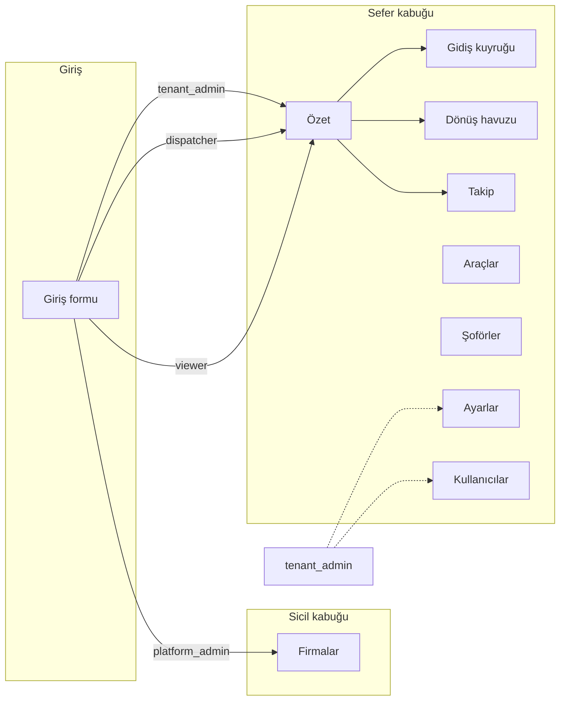

```mermaid
usecaseDiagram
  actor Platform as "Platform yöneticisi"
  actor Admin as "Firma yöneticisi"
  actor Ops as "Operasyoncu"
  actor View as "İzleyici"

  package Sicil {
    usecase UC1 as "Firma aç / listele"
    usecase UC2 as "Firma kullanıcısı ekle"
  }

  package Sefer {
    usecase UC3 as "Özet ve grafikleri oku"
    usecase UC4 as "Gidiş kuyruğunu yönet"
    usecase UC5 as "Gidiş ata"
    usecase UC6 as "Dönüş havuzunu yönet"
    usecase UC7 as "Dönüş hesapla / onayla"
    usecase UC8 as "Canlı takip izle"
    usecase UC9 as "Bildirimleri oku / görüldü"
    usecase UC10 as "Araç ve şoför sicili"
    usecase UC11 as "Arvento çek / Netgsm ayarla"
  }

  Platform --> UC1
  Platform --> UC2
  Admin --> UC3
  Admin --> UC4
  Admin --> UC5
  Admin --> UC6
  Admin --> UC7
  Admin --> UC8
  Admin --> UC9
  Admin --> UC10
  Admin --> UC11
  Ops --> UC3
  Ops --> UC4
  Ops --> UC5
  Ops --> UC6
  Ops --> UC7
  Ops --> UC8
  Ops --> UC9
  Ops --> UC10
  View --> UC3
  View --> UC4
  View --> UC6
  View --> UC8
  View --> UC9
  View --> UC10
```

## 2. Günlük operasyon (özetten kuyruğa)

Operasyoncu veya firma yöneticisi güne **Özet** ile başlar; kuyruk işi **Gidiş** / **Dönüş** sayfalarındadır.

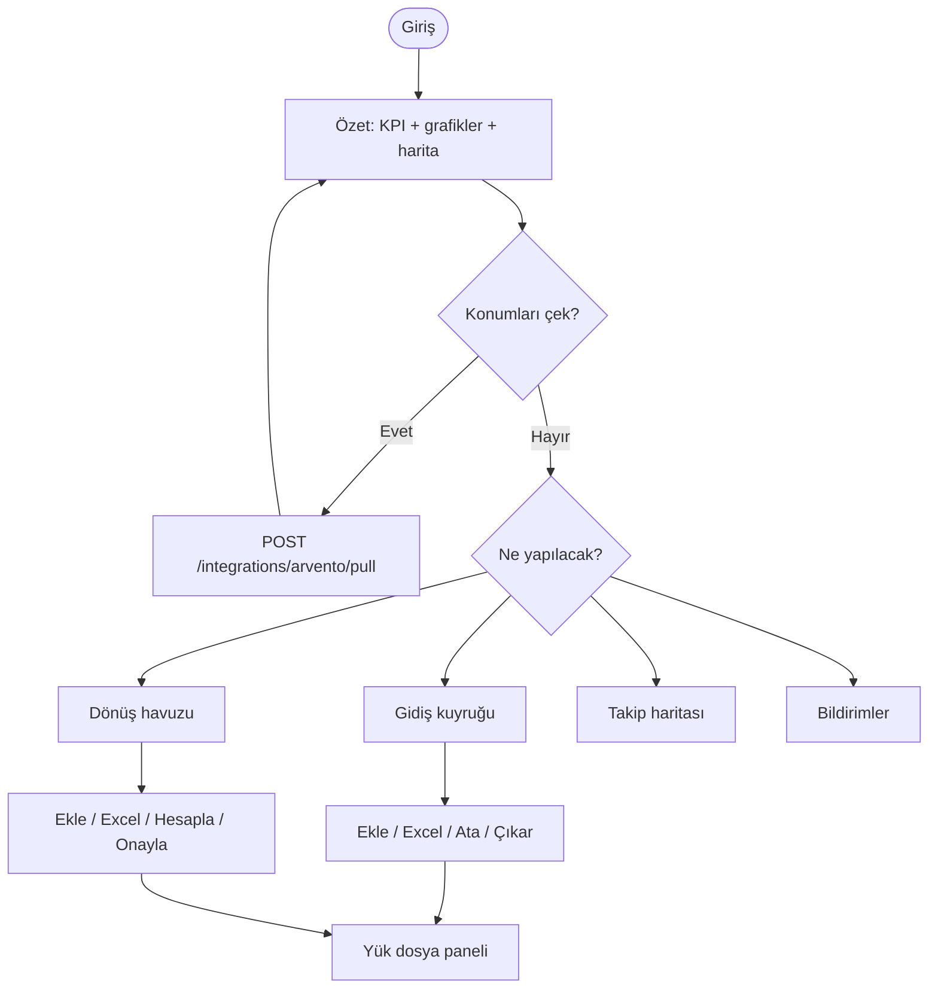

## 3. Senaryo: Gidiş yükü ekle ve ata

**Ekran:** `#gidis` → Ekle veya Excel içe aktar → satır → dosya paneli → Ata.

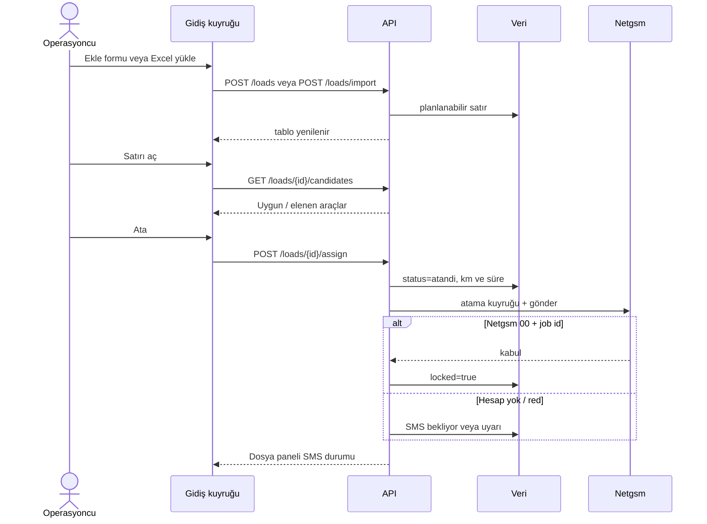

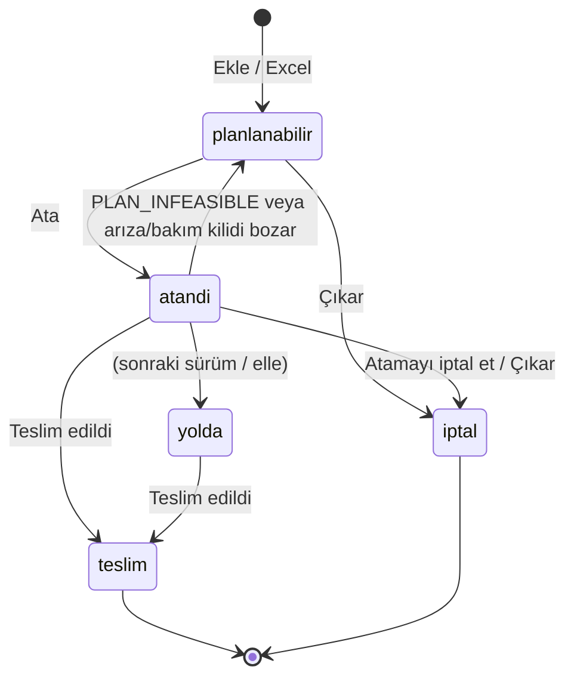

## 4. Senaryo: Dönüş fırsatı ve otomatik eşleşme

**Ekran:** `#donus` → Ekle / Excel (navlun zorunlu) → Hesapla → öneri veya atama → dosya paneli.

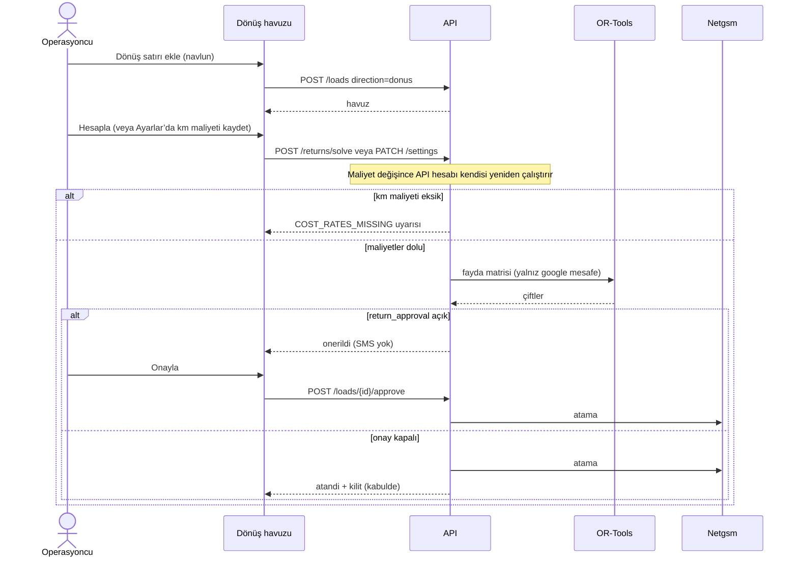

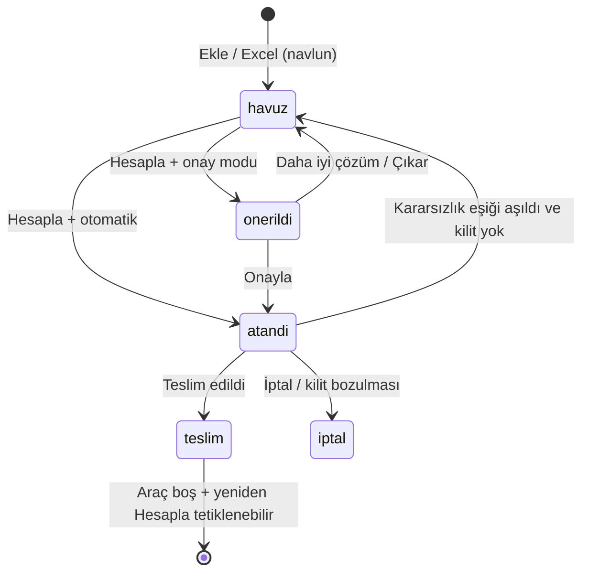

## 5. Senaryo: Excel içe / dışa aktarma

**Ekran:** Gidiş veya Dönüş üst düğmeleri.

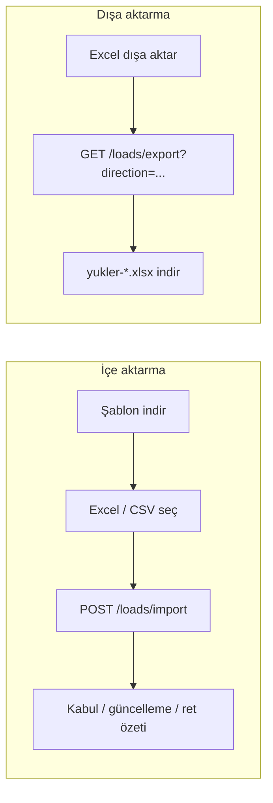

Kurallar:

- İlk satır başlıktır. Zorunlu kolonlar şablondaki gibidir.
- Dönüş satırında `yon=donus` ve `navlun_try` dolu olmalıdır.
- Kilitli / yolda / teslim referans güncellenmez (`ROW_LOCKED`).
- Dışa aktarma `iptal` satırlarını çıkarır.

## 6. Senaryo: Yer güncelleme ve SMS

**Ekran:** Atanmış yük dosya paneli → boşaltma ili/ilçesi → Yeri güncelle.

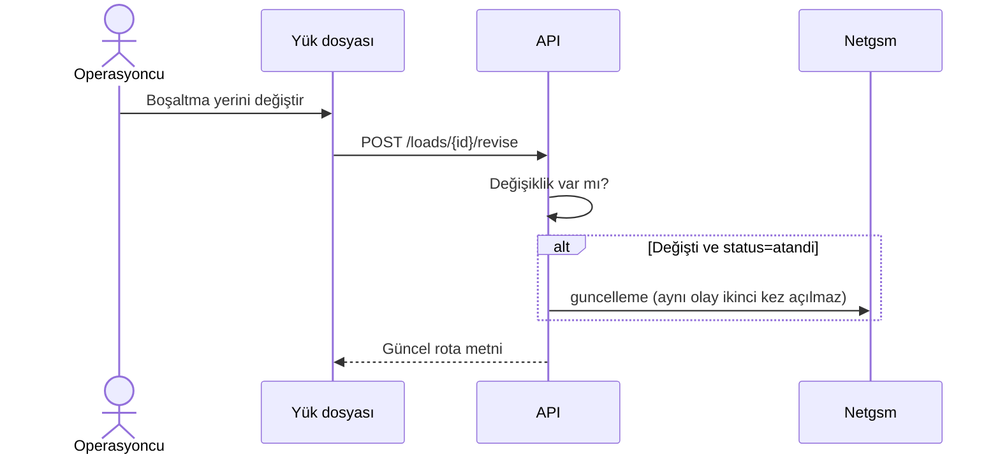

İptal (kilitli atama):

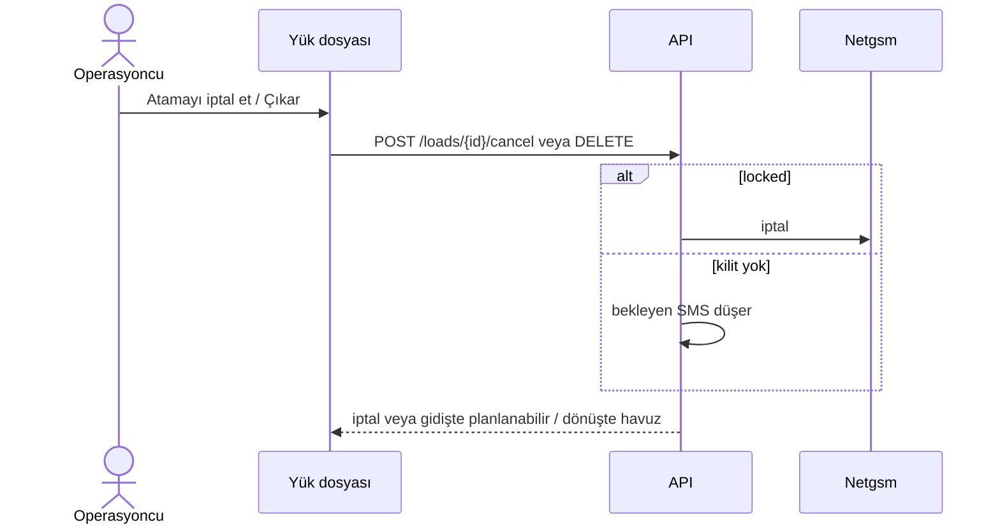

## 7. Senaryo: Canlı takip

**Ekran:** `#takip` (okuma). Konum kaynağı Özet’teki Arvento çekimi veya elle konum.

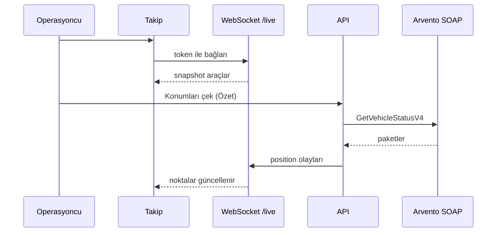

## 8. Senaryo: Uyarı ve takograf

**Ekran:** üst çubuk zil / bildirimler, araç dosyası takograf satırı, yük dosyası kalan süreler.

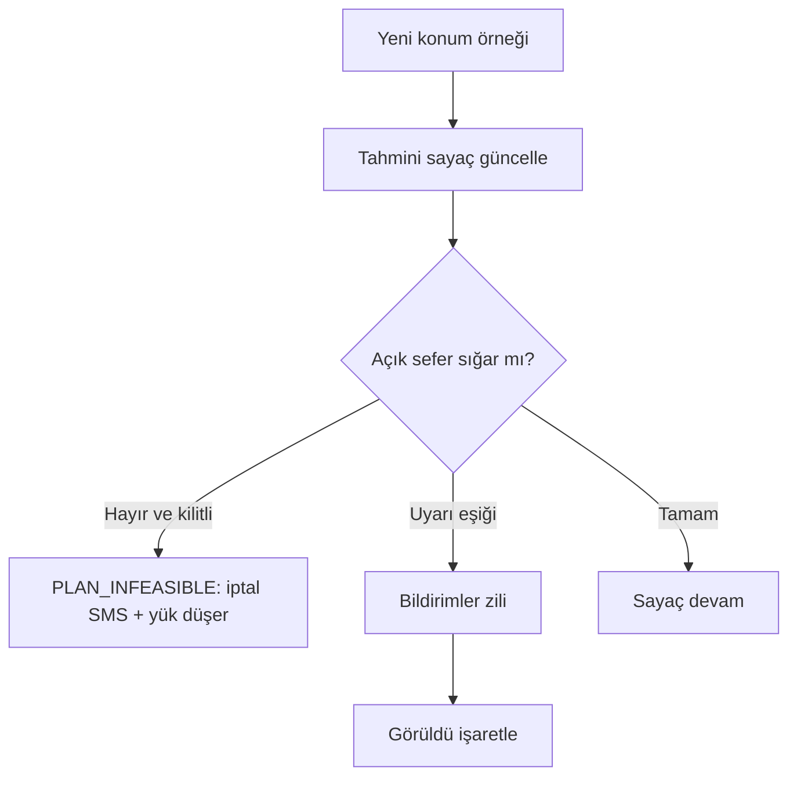

## 9. Senaryo: Ayarlar (firma yöneticisi)

**Ekran:** `#ayarlar`

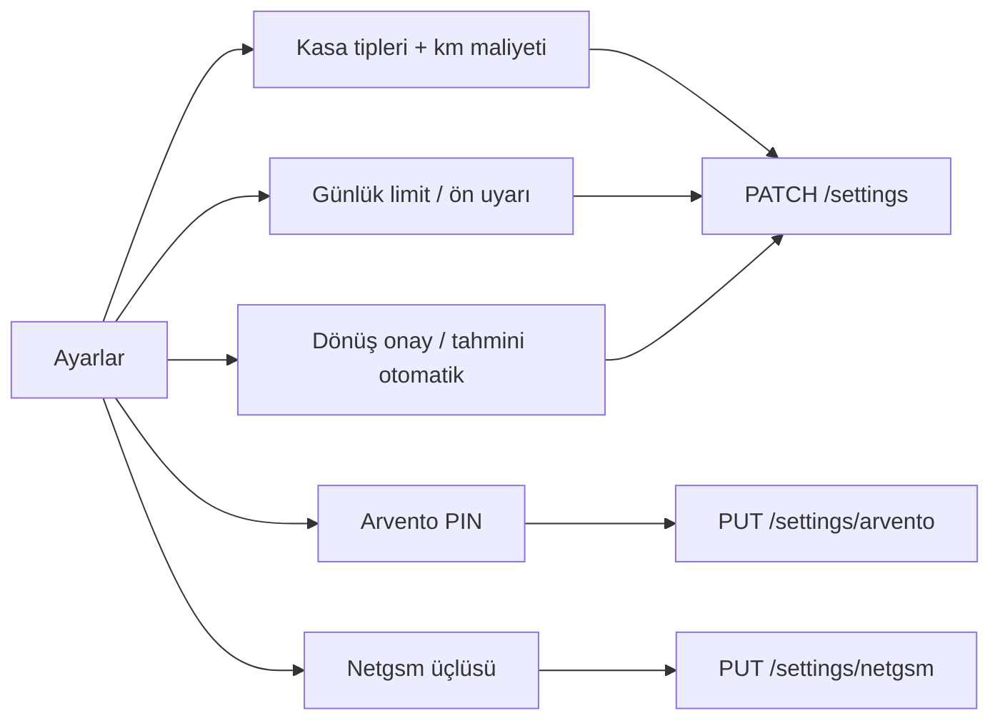

Dönüş hesabı yalnızca iki km maliyeti dolunca çalışır. Netgsm kaydı yoksa atama yine yazılır; SMS bekler, kilit oluşmaz.

## 10. Senaryo: Platform sicili

**Ekran:** `#firmalar`

```mermaid
sequenceDiagram
  actor PA as Platform yöneticisi
  participant UI as Firmalar
  participant API as API

  PA->>UI: Firma aç
  UI->>API: POST /tenants
  PA->>UI: Kullanıcı ekle
  UI->>API: POST /tenants/{id}/users
  Note over PA,API: Operasyon menüsü yok; /loads 403
```

## 11. Sayfa × senaryo matrisi

| Senaryo | Özet | Gidiş | Dönüş | Takip | Bildirim | Araçlar | Ayarlar |
| --- | --- | --- | --- | --- | --- | --- | --- |
| KPI / grafik okuma | ● | | | | | | |
| Arvento çek | ● | | | ○ | | | |
| Gidiş ekle / Excel / ata | | ● | | | | | |
| Dönüş ekle / Hesapla / onay | | | ● | | | | |
| Canlı konum izle | ○ | | | ● | | | |
| Uyarı görüldü | ○ | | | | ● | | |
| Araç durum / şoför | | | | | | ● | |
| Maliyet / Netgsm / bayraklar | | | | | | | ● |

● birincil ekran · ○ yardımcı tetikleyici

## 12. Yük yaşam döngüsü (özet)

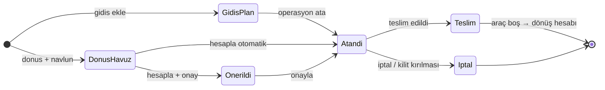
